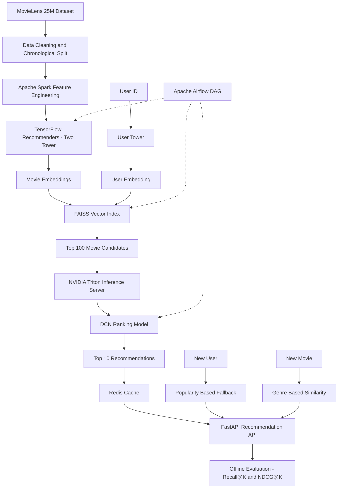

# Movie Recommendation Engine – Architecture

## Architecture Components

1. **Dataset:** MovieLens 25M.
2. **Data Processing:** Cleaning, chronological splitting and Spark feature engineering.
3. **Retrieval:** TensorFlow Recommenders Two-Tower model.
4. **Candidate Search:** FAISS vector index.
5. **Ranking:** Deep & Cross Network (DCN).
6. **Model Serving:** NVIDIA Triton Inference Server.
7. **Caching:** Redis.
8. **API:** FastAPI.
9. **Cold Start:** Popularity-based and genre-based recommendations.
10. **Orchestration:** Apache Airflow DAG (created; execution not yet validated).
11. **Evaluation:** Recall@K and NDCG@K.

## Evaluation Results

- Candidate Recall@1000: 0.186325
- FAISS Recall@10: 0.019557
- FAISS NDCG@10: 0.026232
- DCN Recall@10: 0.010428
- DCN NDCG@10: 0.035931

*Results are from offline warm-start evaluation on 95 users.*
